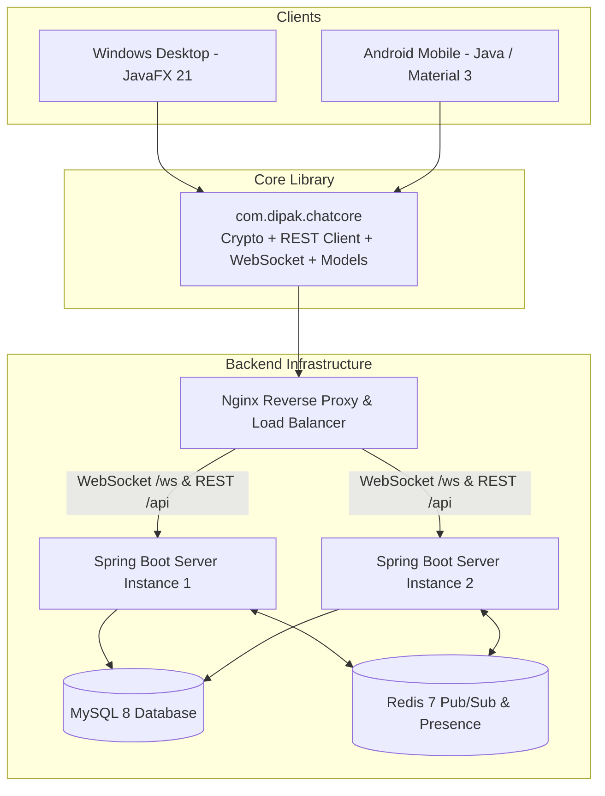

# SecureChat (Windows & Android E2E Encrypted Messenger)

A production-grade, end-to-end encrypted messaging application distributed as a **Windows desktop application (`SecureChat-0.1.0.exe` installer / standalone bundle)** and a **native Android app (APK)**, backed by a Spring Boot cluster with Redis pub/sub and MySQL 8.

---

## 1. Interview Pitch (2-minute pitch)

> "SecureChat is a WhatsApp-style multiplatform messaging application for Windows and Android. All message content and attachments are end-to-end encrypted on the client device using AES-256-GCM and Elliptic Curve Diffie-Hellman (ECDH P-256), meaning the backend server only ever stores and routes ciphertext. The backend scales horizontally across multiple Spring Boot instances using Redis Pub/Sub for cross-node WebSocket messaging, token-bucket rate limiting to prevent abuse, and rotating refresh tokens with automatic reuse detection to stop session hijacking. If a user is offline, messages queue reliably in the database and sync seamlessly on reconnect."

---

## 2. Architecture Diagram



---

## 3. Five Key Design Decisions & Trade-offs

1. **Shared Java 11 Core Library**:
   - *Decision*: Compile the core networking and cryptographic engine to Java 11 bytecode (`options.release = 11`) without Android or JavaFX dependencies.
   - *Trade-off*: Must avoid newer convenience methods (`List.of`, `record`), but achieves 100% code reuse for all cryptographic operations, REST retry loops, and models across Windows and Android.
2. **Password-Derived Encrypted Private Key Backup**:
   - *Decision*: Derive an AES-256-GCM key from the user's password using PBKDF2-HMAC-SHA256 (210,000 iterations) to encrypt the private key backup stored on the server.
   - *Trade-off*: Enables cross-device login without manual file transfer while keeping the server zero-knowledge; however, if the user loses their password, previous message history cannot be decrypted.
3. **Rotating Refresh Tokens with Reuse Detection**:
   - *Decision*: Store only SHA-256 hashes of refresh tokens. Rotate the token on every refresh call and revoke the entire token family if an already-revoked token is re-submitted.
   - *Trade-off*: Increased database write per refresh, but provides defense against stolen token reuse.
4. **Redis Pub/Sub Fanout for Clustered WebSockets**:
   - *Decision*: Clients connect via plain WebSocket (`/ws`) to any Spring Boot node. Messages published to Redis channels fan out to the node holding the recipient's live connection.
   - *Trade-off*: Requires Redis as a shared dependency, but eliminates node-affinity constraints and allows horizontal scaling.
5. **Static ECDH per Conversation**:
   - *Decision*: Derive conversation AES keys using static ECDH + HKDF-SHA256.
   - *Trade-off*: Provides zero-knowledge server privacy with minimal complexity, though per-message forward secrecy (Double Ratchet) is deferred to future milestones.

---

## 4. Five Things I Would Improve

1. **Double Ratchet Protocol**: Implement Signal-style per-message ratchet keys for forward secrecy and break-in recovery.
2. **Voice & Video Calling**: Add WebRTC signaling over the existing WebSocket protocol for peer-to-peer encrypted calls.
3. **Database Sharding**: Partition the messages table by conversation ID or month to handle billions of encrypted records.
4. **Push Notifications**: Integrate unified Apple APNs and Firebase Cloud Messaging (FCM) server-side with encrypted notification payloads.
5. **Multi-device Sync**: Implement Signal-style multi-device pre-key bundles (X3DH) so each device has an independent identity key.

---

## 5. Step-by-Step Getting Started (Windows 11 PowerShell)

### Prerequisites
- **JDK 21**: Oracle JDK 21 or Eclipse Temurin 21.
- **Maven**: 3.9+ for backend (`mvn -version`).
- **Git**: 2.40+.

### Step 1: Start the Backend Server
```powershell
# In PowerShell:
cd "c:\Users\Dipak.Rothe\Desktop\project-chatting application\secure-chat\server"
mvn spring-boot:run
```
The server will start on `http://localhost:8090`.
- Swagger UI: `http://localhost:8090/swagger-ui.html`
- Health check: `http://localhost:8090/actuator/health`

### Step 2: Run the Windows Desktop App
```powershell
cd "c:\Users\Dipak.Rothe\Desktop\project-chatting application\secure-chat"
.\gradlew.bat :desktop:run
```
The JavaFX desktop window will appear. You can register new accounts, search registered users, and send messages.

### Step 3: Run the 2-Minute Demo with 2 Users
1. Open the Desktop app:
   - Click "Register".
   - Name: `Alice`, Email: `alice@test.com`, Password: `Password123!`
   - Log in as Alice.
2. Open a second Desktop instance or call the API:
   - Register Bob: Name: `Bob`, Email: `bob@test.com`, Password: `Password123!`
3. In Alice's window, click **+ New Chat**, search for `bob`, and start chatting!

### Step 4: Package Windows Native App
```powershell
cd "c:\Users\Dipak.Rothe\Desktop\project-chatting application\secure-chat"
.\scripts\package-windows.bat
```
Output will be generated in `desktop\build\dist\SecureChat\SecureChat.exe`.

### Step 5: Run Android App
```powershell
# If Android Studio is installed:
.\gradlew.bat :android:assembleDebug
```
- On Android Emulator: Connects to server via `http://10.0.2.2:8090`.
- On Physical Phone: Set Server URL to your PC's local LAN IP (e.g. `http://192.168.1.15:8090`).

---

## 6. Troubleshooting Table

| Issue | Cause | Fix |
|---|---|---|
| `Connection refused` in Desktop app | Backend server is not running | Run `mvn spring-boot:run` in `server/`. |
| `Cannot connect from Android phone` | Windows Firewall blocking port 8090 | Add an Inbound Rule in Windows Firewall allowing TCP port 8090. |
| `jpackage failed` | JDK 21 bin not in PATH | Ensure `C:\Program Files\Java\jdk-21.0.12.1\bin` is in PATH. |
| `401 Unauthorized` | Invalid or expired credentials | Log in again; refresh tokens rotate automatically. |
| `Database connection error in production` | MySQL not ready | Ensure Docker containers are running via `docker compose ps`. |
