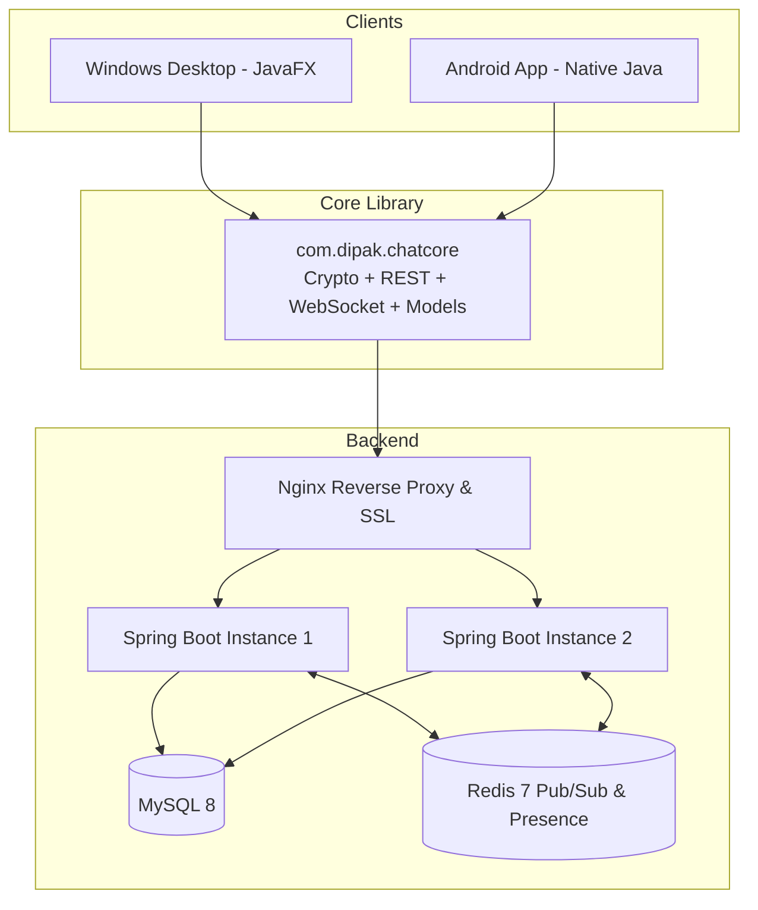

# SecureChat — Architecture & Technical Design

## 1. System Overview

SecureChat is an end-to-end encrypted messaging system designed for personal and team communication across desktop (Windows) and mobile (Android) devices. The system consists of:

- **Server (`server/`)**: Spring Boot 3.3.5 backend providing stateless REST APIs, real-time WebSocket communication, MySQL persistence, and Redis pub/sub message distribution across clustered instances.
- **Shared Core (`core/`)**: Java 11 library shared between Windows and Android clients. Encapsulates network communication (OkHttp), JSON serialization (Gson), cryptography primitives (AES-GCM, ECDH, HKDF, PBKDF2), and abstractions for secure key storage and local caching.
- **Desktop (`desktop/`)**: JavaFX 21 application for Windows, featuring dark/light themes, background asynchronous execution, SQLite local cache, and system tray integration.
- **Android (`android/`)**: Native Java Android application (minSdk 26, targetSdk 35) using Material 3, Android Architecture Components (ViewModel, LiveData), Room database, and EncryptedSharedPreferences.



## 2. Monorepo Layout

```
secure-chat/
  server/        Spring Boot API + WebSocket (Maven)
  core/          Shared Java library used by BOTH apps (Gradle)
  desktop/       Windows app, JavaFX (Gradle)
  android/       Android app, Java (Gradle)
  scripts/       package-windows.bat, helper scripts
  docs/          ARCHITECTURE.md, API.md, PROTOCOL.md, SECURITY.md, STATUS.md, MANUAL_STEPS.md
  deploy/        docker-compose.prod.yml, nginx.conf
  .github/workflows/ci.yml
  settings.gradle   (includes core, desktop, android)
  README.md, PLAN.md, .gitignore
```

## 3. Technology Choices and Rationale

| Layer | Technology | Rationale |
|---|---|---|
| Server Runtime | Java 17, Spring Boot 3.3.5 | Modern enterprise Java LTS runtime with robust ecosystem and security features. |
| Database | MySQL 8 + Flyway | Production-grade relational store with strict migration versioning (`ddl-auto: validate`). |
| In-Memory Cache | Redis 7 (Lettuce) | Token bucket rate limiting, ephemeral presence tracking, and multi-instance Pub/Sub message fanout. |
| Shared Core | Java 11 bytecode (`options.release = 11`) | Highest common denominator between Android runtime (minSdk 26) and desktop JVM without desugaring issues. |
| Desktop UI | JavaFX 21 + CSS | Hardware-accelerated native-looking GUI; CSS styling allows clean light/dark theme toggling. |
| Desktop Packaging | JDK `jpackage` | Packages a zero-dependency self-contained Windows application bundle (`.exe` or standalone runtime). |
| Android Architecture | Java + Material 3 + Room | Modern lifecycle-aware MVVM architecture adhering to standard Android enterprise guidelines. |

## 4. End-to-End Encryption Architecture

1. **Zero Knowledge Server**: The server stores only ciphertext (`messages.ciphertext`), IVs, and key metadata. Plaintext message bodies and encryption keys are never sent to or visible on the server.
2. **Device Identity Keys**: Each client generates an EC P-256 key pair at registration time. The public key is registered with the server.
3. **Password-Derived Backup**: The private key is encrypted with AES-256-GCM using a key derived via PBKDF2-HMAC-SHA256 (210,000 iterations) from the user's password, allowing cross-device restore without server knowledge.
4. **Direct Messaging**: ECDH shared secret derivation followed by HKDF-SHA256 produces a unique 32-byte AES key per conversation.
5. **Group Messaging**: Group administrator generates a random 32-byte group key, wrapped individually for each member via ECDH, and rotated on member changes.
